# Gemini Notebook hands-on results

Measured on 6 November 2026 in a new notebook, "Learnin teardown test", on an account with a Pro badge. Claude ran the session through Claude in Chrome and scored the answers. This is one sitting, one rater and 24 questions, so treat the numbers as a directional baseline.

## 1. Summary: the 10 findings that matter most for our design

1. **Answers are accurate and slow.** 22 of 24 were fully correct (46/48 points, 95.8%), but time to first word averaged **19.7 s** (median 17.3 s, range 11.9–52.6 s). Our target is under 2.5 s (§1.2). Speed is our clearest opening.
2. **Scans and figures work, which corrects the desk research.** Gemini derived an equation from a scan with no text layer and read numbers that exist only inside a drawing (Q13, Q15). Better vision alone won't differentiate us.
3. **Where a citation lands is its weakest point.** In text PDFs and web pages, a click highlights a passage of about 600 characters. On a scan or image, it opens the source at the top with no highlight. On YouTube, it highlights **the entire transcript** and stays at the top, and the player doesn't seek.
4. **There are no timestamps for video.** The transcript viewer shows none, and answers can't give any. Q20 said so honestly; Q19 didn't mention it. Our `{startMs, endMs}` locator (§3.5) is a real gap to exploit.
5. **Uploaded video is audio only.** A silent clip failed with "No speech detected". A clip with speech worked, but text shown only on screen was unavailable (the answer said so). `.vtt` and `.srt` are rejected. Our keyframe path and transcript parsing (§4.2) would both be real advantages.
6. **Web import can cut off silently.** A 9 MB page imported only about 36,000 characters, ending partway through, with no warning at import. Chat later noticed and declined to guess (Q04). We should show completeness at ingestion.
7. **Abstention held up.** 2/2 unanswerable questions, plus Q04, with no false refusals. The response-level unsupported-claim rate was **3/24 (12.5%)**, close to the published 13%, with the same "interpretive overconfidence" pattern (Q22). This is a real bar to beat, though the sample is small.
8. **Chat runs a visible, multi-step retrieval flow.** One long stream shows search steps and short reasoning summaries ("Thoughts"). Some questions search twice. Each stream carries a block of about 420 KB of passages when all six sources are selected, about 47 KB with one.
9. **The transport is expensive and we shouldn't copy it.** Every frame resends the whole answer state, passages included. Questions averaged **13 MB decoded** (up to 42 MB, 13 MB even after compression). Our delta stream (§6.3) is right.
10. **Cost is more visible than the desk research says, and study outputs are more editable.** Studio dialogs show an "AI usage" bar with used and estimated cost, offer "Generate later", and can prompt for web notifications. Quiz questions can be edited. Our remaining edge on budgets is real dollars, not visibility.

### Corrections to the desk research

| Desk research said | Observed |
|---|---|
| Scans need OCR first; figures and handwriting aren't analysed | Scan and figure questions all correct. Handwriting is only tested with a synthetic font |
| Tables flatten into prose | The Attention paper's tables render as real tables and were read correctly (Q09–Q11) |
| Math extraction often fails | Partly true. Answers render math well, but viewer text is messy: broken subscripts in PDFs, tripled KaTeX text in web pages |
| Viewer always shows extracted text | Only for text PDFs and web pages. Scans and images show the original page |
| No notification when Studio finishes | A prompt to turn on web notifications appears after the first generation |
| Budget is opaque | Numbers are hidden, but a bar shows used and estimated cost before generating, and a toast gives the reset time |
| Notebooks are flat, no folders | A **Collections** page with "New collection" now exists, plus "Auto-label your sources by topic" |
| Not in the desk research | Built-in open **Textbooks** catalogue, Play Books import, Interactive reports, "Generate later", connected apps, "Reviewed outline" steps for slides and video |
| Quiz has multiple question types to pick | The dialog only offers count, difficulty, language, sources and topic. The sampled questions were multiple choice |
| Citations survive saving to a note | Confirmed. Saved answers are view-only until you choose "Edit your note" |

### What this report doesn't cover

- **Not tested:** real handwriting (none supplied, so S6 is a synthetic font), Interactive/Join audio and the Deep Dive, Critique and Debate formats (budget), Cinematic video generation, mobile share sheet, and the Document report templates.
- **Not found:** no code or "cloud computer" feature appeared on this account.
- **Scoring limits:** one rater, and it's me. Citation checks compared the first ~100 characters and the passage position, which is lenient. I didn't read the last lines of Q07, Q08 and Q21, or all of Q22, so their unsupported-claim counts are lower bounds.
- **Drive connector:** a Google Drive toggle in chat was already on and I left it unchanged. No answer cited Drive.

## 2. Source ingestion

"Ready" means the row's spinner became a checkbox. The source guide can still be loading at that point (it was for the scan and YouTube sources).

| Source | Size | Add → ready | Viewer shows | Tables / math / figures | Notes |
|---|---|---|---|---|---|
| S1 Attention paper PDF | 2.2 MB, 15 pp | about 11 s | Extracted text with figures | Real tables; equations flattened with broken subscripts | Guide plus 5 topic chips |
| S3 CIML textbook PDF | 3.9 MB, 227 pp | under 20 s | Extracted text with figures | Equations flattened | Fast for the size |
| S2 Nature scan PDF | 0.5 MB, 4 pp, no text layer | 13.2 s | **Original page images** | Visible as scanned | Guide still loading when first opened |
| S4 YouTube lecture | about 60 min | 4.6 s | Embedded player plus plain transcript | n/a | **No timestamps.** A popular video, so possibly cached |
| S5 Annotated Transformer web page | 9.4 MB HTML | 9.8 s (title at 4 s) | Reader text with code blocks and links | 29 code blocks kept; math text tripled | **Stops after the learning-rate section**; later sections missing, no warning |
| S6 Note image (synthetic) | 0.1 MB | 7.9 s | Original image | n/a | Guide described it correctly |
| Pasted text | 300 chars | 3.5 s | Editable note | n/a | **Becomes a note**, which doesn't count toward the source limit |
| Speech video `.mp4` | 0.2 MB | 9.1 s | Transcript only, no player | On-screen text not indexed | Shown with an audio icon |
| Silent video `.mp4` | 1.1 MB | failed at 6.6 s | n/a | n/a | "No speech detected"; "Remove all failed sources" offered |
| `.vtt`, `.srt` | small | rejected at once | n/a | n/a | Not in the accepted list. One bad file rejected the whole batch, including a valid `.mp4` |
| Fast Research import (RoFormer) | web | under about 12 s | n/a | n/a | Standard ingestion |

Limits seen: a 6/300 counter in the add dialog (matching the reported Pro limit). The file picker accepts PDF, text, Office, EPUB, audio, video and image formats, plus HWP/HWPX.

## 3. Chat Q&A score sheet

Questions and expected answers were written first, in [`evals/golden/v0.questions.json`](../../evals/golden/v0.questions.json). Full data is in [`evals/golden/v0.notebooklm-baseline.json`](../../evals/golden/v0.notebooklm-baseline.json). Each question ran after deleting chat history, because a notebook has only one thread. "n/c" means not captured.

Sources were S1–S6 selected, with the pasted note and test video deselected. Timing uses in-page timers from Enter to the first answer text and to the input re-enabling.

| Q | Type | Expected | TTFT s | Total s | Words | Correct | Unsupported | Passage ok/checked | Granularity | Abstain | Notes |
|---|---|---|---|---|---|---|---|---|---|---|---|
| 01 | lookup | S1 p.7 sec 5.3 | 13.0 | 20.0 | 109 | 2 | 0 (0 uncited) | 4/4 | passage ~530-630 chars, highlighted in extracted | n/a | Timed by panel-text sampling, not the final harness. Cites both the PDF and the blog quoting it, though the question names the paper. Ends with a suggested follow-up. |
| 02 | lookup | S1 p.7 sec 5.1 | 12.8 | 15.8 | 43 | 2 | 0 (0 uncited) | 2/2 | passage ~600-1040 chars | n/a | Times, words and stream from the re-run (harness bug on first run gave no TTFT; first run total 13.7 s, 70 words). Same answer both runs. |
| 03 | lookup | S5 make_model code block, Full Model  | n/c | 18.1 | 102 | 2 | 0 (0 uncited) | 4/4 | passage ~440-810 chars | n/a | TTFT not captured (harness bug). 2 citations hidden behind an overflow control were not opened. Correctly notes src_vocab and tgt_vocab have no defaults. |
| 04 | lookup | S5 A First Example, example_simple_mo | 52.6 | 55.1 | 121 | 2 | 0 (0 uncited) | 2/2 | passage ~600 chars | n/a | Noticed the import stops before the section and declined to guess; offered web research. Slowest answer: repeated search rounds. The live page says 80. |
| 05 | explain | S1 p.4 sec 3.2.1 and footnote 4 | 14.5 | 20.1 | 323 | 2 | 1 (2 uncited) | 7/7 | passage ~410-830 chars | n/a | Two uncited explanatory sentences, both correct. The softmax-extremes sentence adds background not in the source. |
| 06 | explain | S1 p.6 sec 3.5 | 16.5 | 20.3 | 254 | 2 | 0 (0 uncited) | 6/6 | passage ~440-930 chars | n/a | Clean. Math rendered with KaTeX. |
| 07 | explain | S4 about 5:10 | 16.9 | 22.2 | 310 | 2 | 0 (0 uncited) | 7 source-level only | hover: passage | n/a | Hover text not captured in this run, so passages are unverified (facts match the transcript). Last sentences not read. |
| 08 | explain | S3 p.120 sec 9.3 | 18.6 | 24.7 | 369 | 2 | 1 (0 uncited) | 2/2 | passage ~780-1100 chars | n/a | Long for a simple concept. Adds "frequently co-occur", which the source does not say. Last sentences not read. One citation not captured. |
| 09 | table | S1 p.8 Table 2 | 13.8 | 16.0 | 83 | 2 | 0 (0 uncited) | 2/2 | table passage ~750-810 chars | n/a | Table read and subtraction both right. |
| 10 | table | S1 p.8 Table 2 | 16.4 | 19.1 | 83 | 2 | 0 (0 uncited) | 1/1 | table passage ~810 chars | n/a | Scientific-notation arithmetic right: about 23.33x. |
| 11 | table | S1 p.9 Table 3 row (A) | 17.9 | 21.7 | 129 | 2 | 0 (0 uncited) | 2/2 | table passage ~960 chars | n/a | Reconstructed the multi-row group (A), including the base row. Also found the 0.9 BLEU remark in the text. |
| 12 | math | S1 p.7 eq 3 | 20.9 | 29.0 | 356 | 2 | 0 (2 uncited) | 4/4 | passage ~575-930 chars | n/a | Final value checked on a re-run (TTFT 30.3 s, total 40.1 s, 399 words): step 4000, about 0.000699. Uncited arithmetic steps are correct. |
| 13 | math | S2 PDF p.2 (journal p.534) eqs 2, 4,  | 15.3 | 23.2 | 520 | 2 | 0 (3 uncited) | 2 source-level only | hover: page thumbnail | n/a | Derivation from a scan with no text layer is fully right. Uncited calculus steps are correct. Citation for eq 4 (p.2) showed a thumbnail starting at p.1. |
| 14 | scanned_image | S2 PDF p.2 Fig 1 caption | 11.9 | 14.0 | 66 | 2 | 0 (0 uncited) | 1 source-level only | hover: page thumbnail | n/a | Read from the Fig 1 caption in a scan. |
| 15 | scanned_image | S2 PDF p.2 Fig 1 diagram | 37.5 | 40.9 | ~150 | 2 | 0 (0 uncited) | 1 source-level only | hover: page thumbnail | n/a | Read values that exist only inside the drawing (6.4, -8.8, -1.1). Word count not captured; about 1000 characters. |
| 16 | scanned_image | S6 whole image, lines 3-5 | 17.3 | 19.8 | 65 | 2 | 0 (0 uncited) | 1/1 | whole image | n/a | All three facts right. The note is a synthetic handwriting-style font, so this does not prove real handwriting works. |
| 17 | long_source | S3 p.121 sec 9.3 | 12.4 | 14.8 | 110 | 2 | 0 (0 uncited) | 1/1 | passage ~1100 chars | n/a | From the middle of a 227-page book. Viewer scrolled to the passage. |
| 18 | long_source | S3 p.113 sec 8.5 eqs 8.23-8.24 | 17.5 | 21.5 | 184 | 2 | 0 (0 uncited) | 3/3 | passage ~540-620 chars | n/a | First attempt vanished from the UI when sent 2 s after deleting chat (the request still completed); probably a race with that delete. Scored on the retry. |
| 19 | video | S4 about 12:50-13:10 | 24.8 | 29.1 | 216 | 1 | 0 (0 uncited) | 4/4 | hover: passage | n/a | Example right. "At what point" answered by topic, with no time, and no warning that timestamps are unavailable. |
| 20 | video | S4 about 1:55 and about 5:10 | 27.0 | 30.0 | 77 | 1 | 0 (0 uncited) | 3/3 | hover: passage | n/a | All numbers right. States that the transcript has no timestamps and offers web research. Scored 1 because the timestamps asked for were not given. |
| 21 | multi_hop | S1+S5 S1 p.7 eq 3 | 17.8 | 22.9 | 247 | 2 | 0 (0 uncited) | 3/3 | passage ~250-630 chars | n/a | Found both differences and quoted the code block. Last sentences not read. |
| 22 | multi_hop | S1+S4 S1 p.7 end of sec 4 | 18.9 | 29.1 | 548 | 2 | 1 (0 uncited) | 4/4 | passage ~170-1040 chars | n/a | Interpretive overconfidence: says attention offers "a direct window" into reasoning, where the paper only says "could yield more interpretable models". Very long. Only the first part was read closely. |
| 23 | unanswerable | none not in any source | 13.7 | 16.8 | 84 | 2 | 0 (0 uncited) | 2/2 | passage ~810-1200 chars | yes | Abstained, then listed what the sources do cover. First attempt vanished when sent 2 s after deleting chat; scored on the retry. |
| 24 | unanswerable | none not in the lecture | 26.1 | 29.3 | 129 | 2 | 0 (0 uncited) | 1/1 | hover: passage | yes | Abstained, then gave the Llama 2 figures as adjacent, clearly labelled context. Two search rounds. |

### Aggregates

| Metric | Result |
|---|---|
| Mean / median TTFT | 19.7 s / 17.3 s (23 questions) |
| Mean / median total time | 23.9 s / 21.6 s |
| Accuracy | 46/48 points (95.8%); 22/24 fully correct. Both partial scores are the timestamp questions |
| Response-level unsupported-claim rate | 3/24 (12.5%): Q05, Q08, Q22. These are additions or overstatement, not invented facts |
| Answers with uncited but correct sentences | 3/24 (Q05, Q12, Q13) |
| Citation precision | 58/58 checked passages supported the claim (lenient check). 18 more were right at source level only, because a click doesn't locate the passage (scans, or Q07's uncaptured hover) |
| Citation granularity | Text PDF and web: highlighted passage, about 170–1,200 characters, typically 600. Scan: page thumbnail on hover, top of source on click. Image: whole image. YouTube: correct passage on hover, whole transcript highlighted on click |
| Abstention | 2/2 unanswerable. Q04 also correctly declined. No false refusals in 22 answerable questions |
| Answer length | Mean 197 words; 43 to 548. Explain and compare questions run long |
| Follow-up prompt | Most answers end with a suggested next question, often after an emoji |

### Other chat tests

| Test | Result |
|---|---|
| Scoping | With only S1 selected, a question about the deselected textbook got no citations. It named `ciml.pdf` as deselected and offered to check it. So the model sees source **names** outside the selection, but not their content |
| Default vs. modes (same question as Q05) | Default 323 words. Shorter 155 words. Learning Guide 205 words, ending "Does this explanation make sense…" Custom (beginner tutor, 80 words max) 75 words with a microphone analogy and a check question. Learning Guide is lighter than "Socratic": it explains first, then checks |
| Configure chat | Goal: Default / Learning guide / Custom (10,000 characters). Length: Default / Longer / Shorter |
| 10-turn memory | Turn 11 quoted the first question word for word. My planted fact never arrived: turn 1 was replaced by a stock prompt I didn't type ("In one or two sentences, how can you help me use these sources?"), so fact recall wasn't tested. Cause unknown; it may be my automation pressing Enter while an autocomplete suggestion was active |
| Save to note | The citation survived and still works. The note was auto-titled, is view-only until "Edit your note", and joined the sources list with a checkbox |
| Outside knowledge / web | No toggle in chat. Several answers offer web research, and asking explicitly works. It correctly reported 80 in the 2022 version and 30 in the 2018 one in 51 s, but with **no citation markers** and no clear label that it left the sources |
| Mind map handoff | Clicking a node sends a templated prompt: "Discuss what these sources say about X, in the larger context of Y" |

## 4. Power-user features

Generation ran over the 6 sources. Times are approximate: start to first seen ready, from a 1-second poll and screenshots. Usage is the bar's estimate as a share of the current window.

| Feature | Time | Est. usage | Customisation | Quality check | Links to sources |
|---|---|---|---|---|---|
| Audio Overview (Brief) | about 2.7–3.3 min for 1:37 of audio | about 10% | Deep dive / Brief / Critique / Debate, language, length (not for Brief), sources, focus prompt | Not listened to in full. Title fits; 11 s played | "View 6 sources" only. Player has speed, ±10 s, queue. **No Join control** on this Brief episode |
| Video Overview (Short) | about 11–12.5 min for 75 s | about 9% (Explainer 11%) | Cinematic ("will generate in a few hours… upgrade to get it sooner"), Short, Explainer; visual styles including Classic, Whiteboard, Kawaii; language; suggested topics; optional producer-notes review | 75 s, vertical 720×1280, downloadable. Watched only the opening frames, which show filler text inside the illustration ("This is a paragraph of hand-drawn text…"), a visible image-model artifact | "View sources" |
| Mind Map | about 18 s | under 1% | Language, sources, topic | Sensible hierarchy over all sources | Node click → chat with citations |
| Reports (Interactive) | under about 80 s | under 1% | Interactive or Document; "Learning overview" template with edit | Structured as a lesson with objectives and table of contents; embeds "Recommended · Flashcards" cards you can Add | **No inline citations**; "View 6 sources" |
| Flashcards | under about 40 s | under 1% | Fewer / Standard / More, Easy / Medium / Hard, images on/off, language, sources, topic | 53 cards. First card matches S1. Right/wrong counters, keyboard control, **Explain** button | No per-card citation; Explain goes to chat |
| Quiz | under about 35 s | under 1% | Count, difficulty, language, sources, topic | 10 questions. 5 stems checked, no errors; only Q1's answer was revealed. **Questions can be added, edited or deleted**; optional stopwatch | No per-question citation |
| Infographic | about 1.5–2.5 min | about 3% | Language, orientation, 11+ styles, detail level, prompt | High visual quality. Numbers match the lecture (10 TB, 100x, 140 GB, 6,000 GPUs, 12 days, $2M) | "View 6 sources" |
| Slide deck | about 7 min | about 15% | Detailed or Presenter, language, Short / Default, prompt, optional outline review | 15 slides, polished and legible; title and outline fit the sources. Slides are images. A Revise control and slideshow are offered | "View sources" |
| Data table | under about 15 s | under 1% | Language, sources, prompt | 28 rows, 8 columns, including a text "Source" column. Sampled facts match S1 | Text "Source" column only |
| Fast Research | under 8 s | not shown | Web or Drive | 10 sources, all relevant by title and summary; mostly arXiv. All selected by default | Review list, per-item open link, then Import |
| Deep Research | under about 4 min | not shown | Web or Drive | 5 progress steps; a report with `[cite: n]` markers; 29 cited and 9 not-cited sources. Report not read in full | Report plus sources import together. Not imported in this test |
| Sharing (viewed only) | n/a | n/a | People and groups, roles, notify toggle, Restricted or link access | Left Restricted; nothing shared | Artifacts also have their own share icon |
| Analytics | n/a | n/a | n/a | Needs a notebook shared with at least 4 other users | n/a |

**Usage.** The bar was at 57% after ingestion and about 37 chat turns, so roughly 1.5% per question, though I can't separate ingestion cost. It reached about 93% with everything above. A toast then warned the limit was near, with a reset time and an Upgrade button. No trial or purchase was started.

## 5. UI/UX notes

Screenshots are in [`notebooklm-screens/`](./notebooklm-screens/). The avatar and other notebooks' titles are blacked out.

**Home.** Top tabs All, My notebooks (shown once you have a few), Discover, Collections. Grid or list, sort by Most recent or Title, search across your notebooks and public ones, featured row above your notebooks. Collections is an empty "My collections" page with a "New collection" button; I didn't create one. 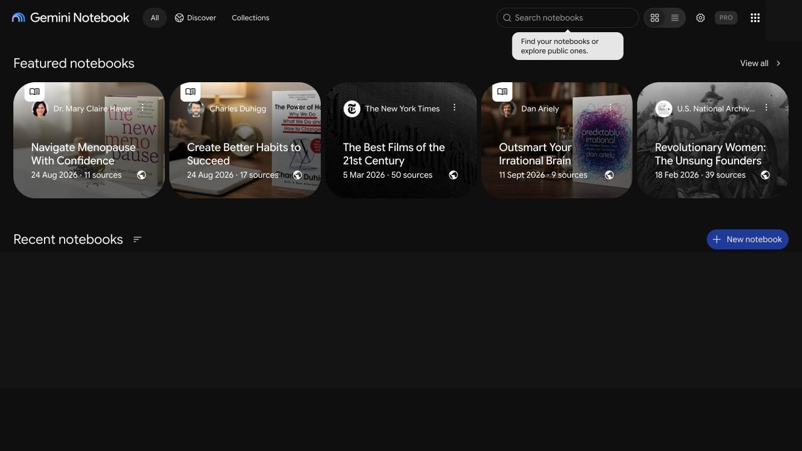

**New notebook.** No wizard. "Untitled notebook" opens at once with three panels and goal chips (learn a topic, create something, make progress on a project). 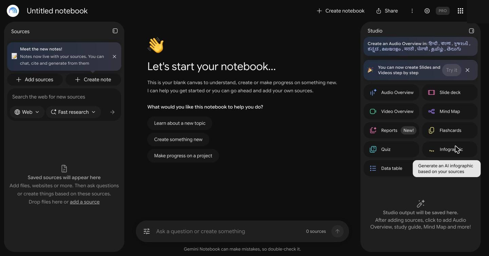

**Add sources.** Search the web, or Upload, Websites, Play Books, Drive, Textbooks, Copied text. The dialog's headline rotates to teach use cases. 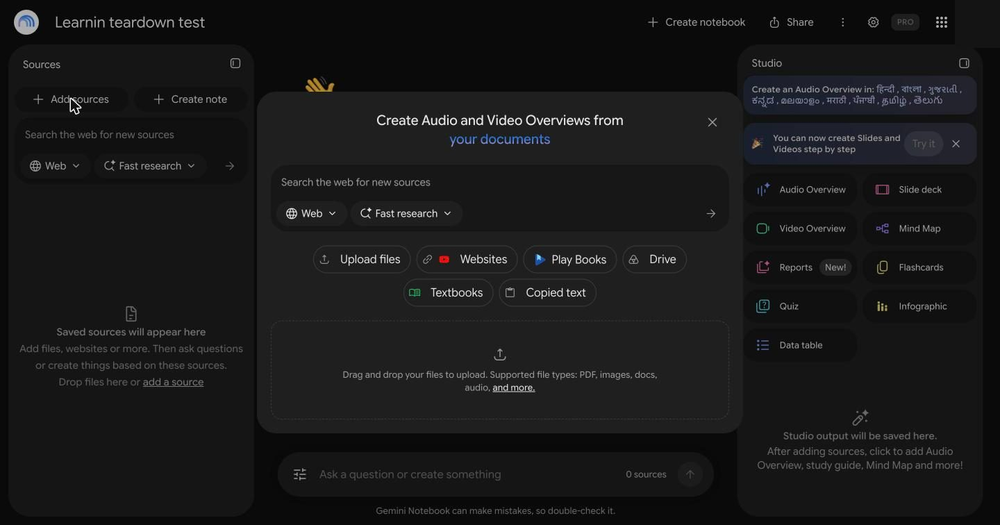 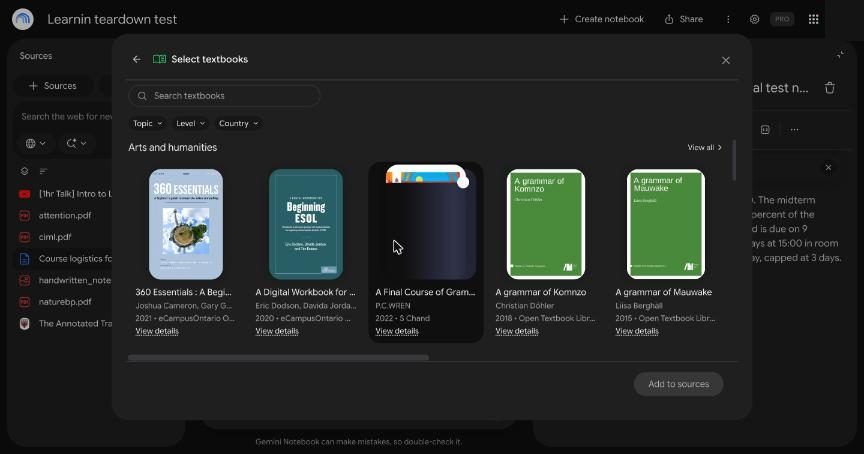

**Answer rendering.** Answers are a structured element tree, not Markdown, with status lines, a "Thoughts" expander, KaTeX math and two-per-claim citations where the blog quotes the paper. 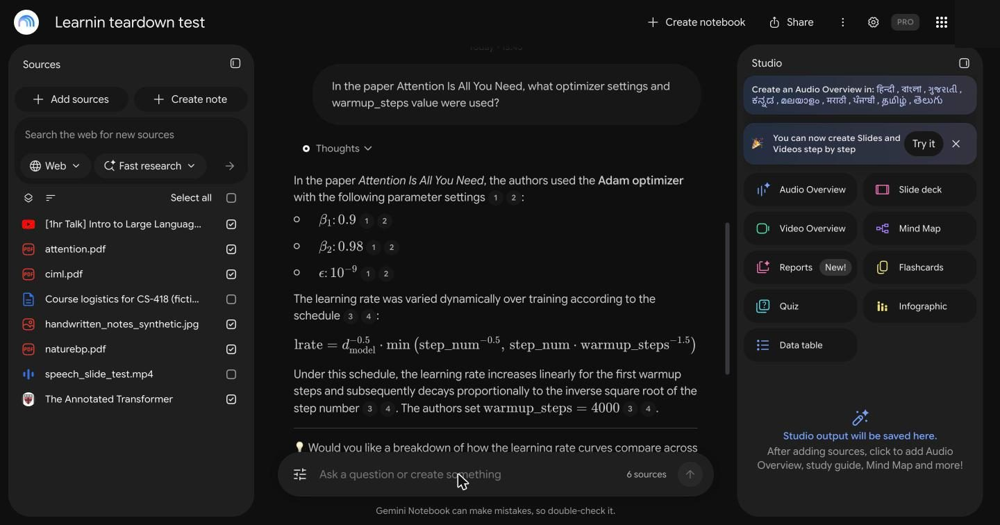

**The citation loop by source type.**

- Text: hover shows the passage, click highlights it. 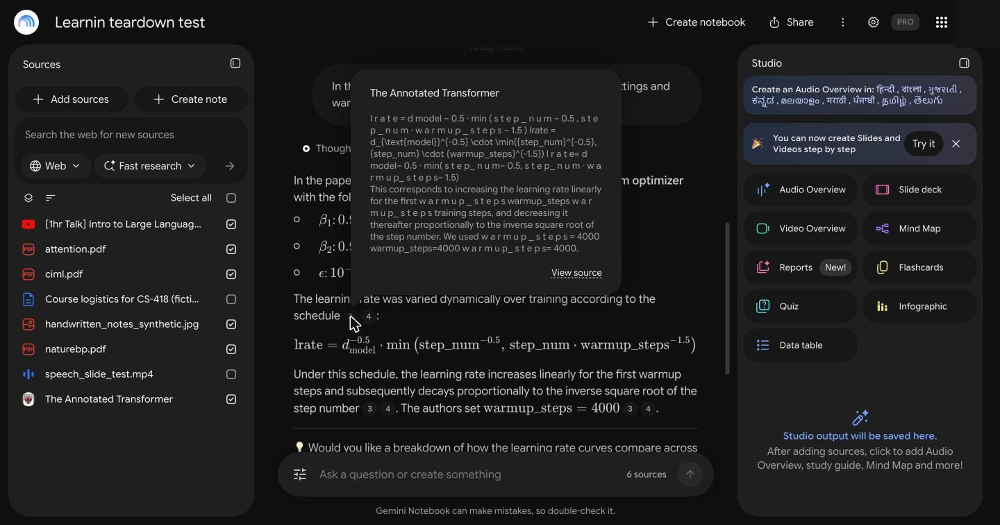 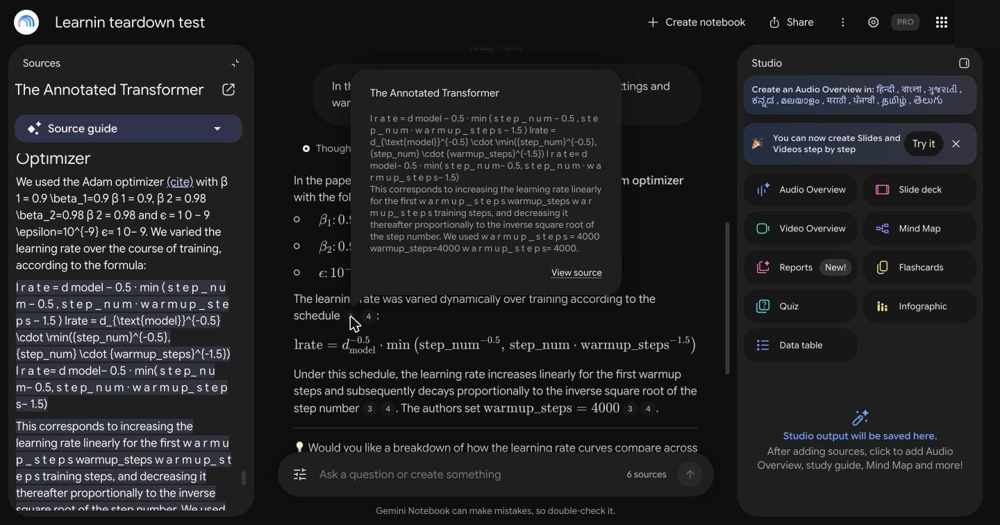
- Scan: thumbnail on hover, top of source on click. 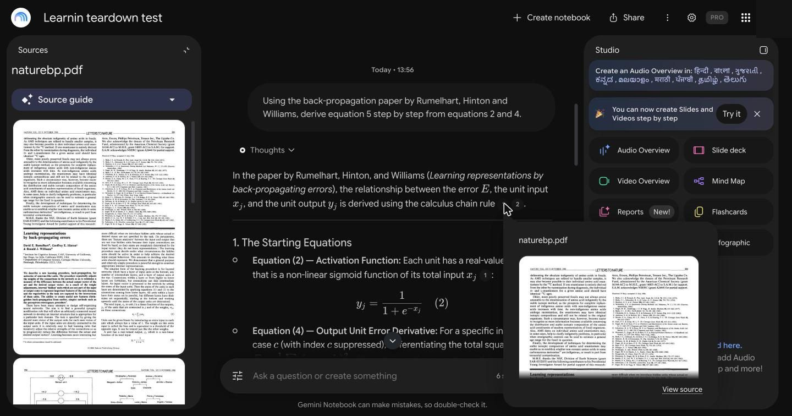
- YouTube: right passage on hover, whole transcript highlighted on click. 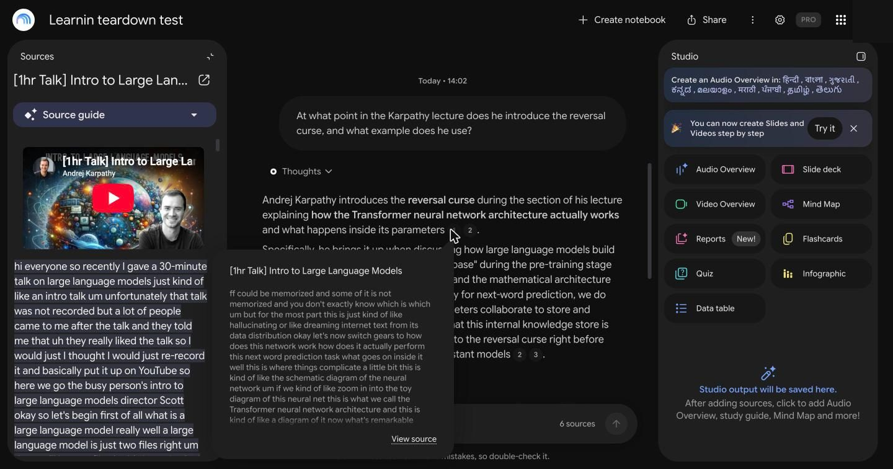

**Studio.** New outputs stay as tiles, as the desk research said. Dialogs share one pattern: options, usage bar, "Generate later", "Generate now". 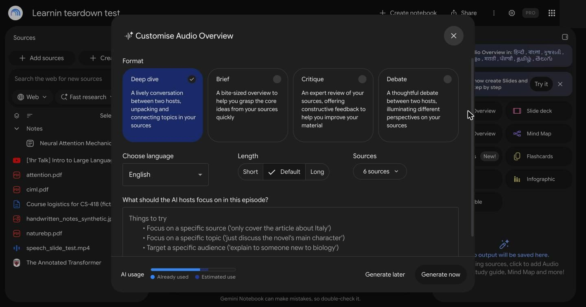 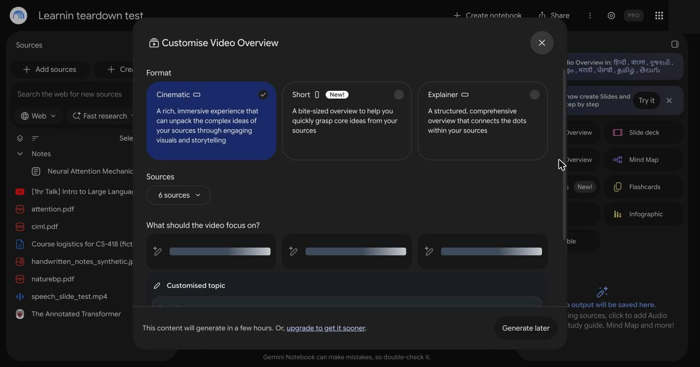

**Slides and video.** 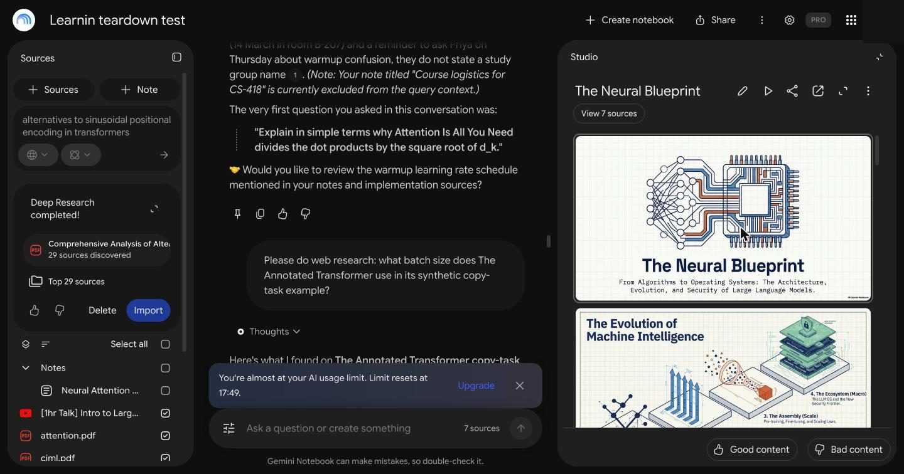 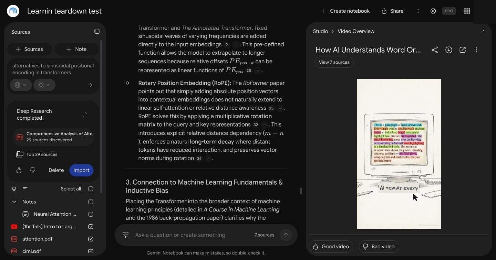

**Study outputs.** 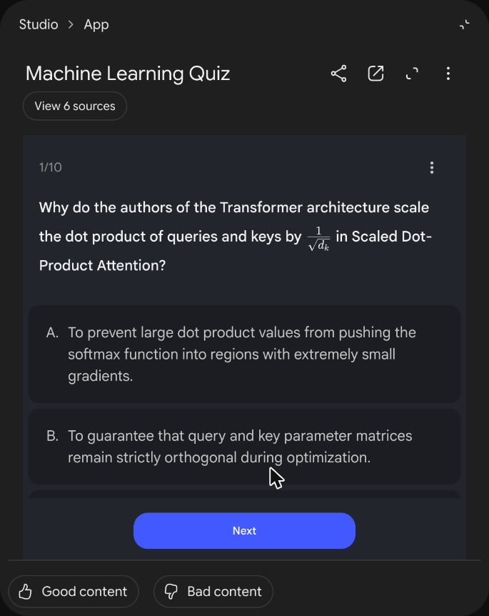 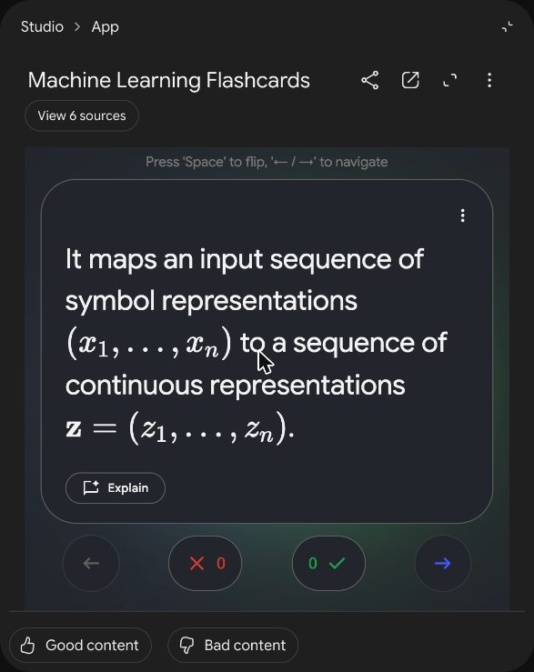 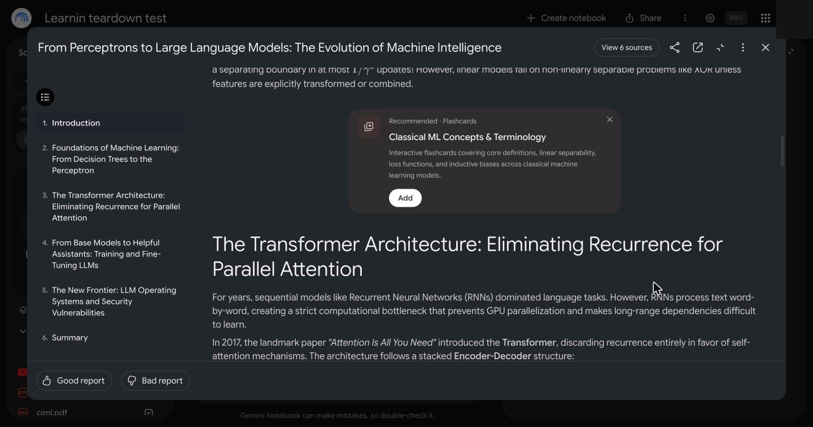

**Rough edges seen.** Clicks right after closing a dialog often only showed a tooltip. Two questions sent 2 s after deleting chat vanished with no error, although their requests finished (and presumably used budget). A batch with one bad file type fails entirely, with a long message. Hidden source state is real: the note and video stayed deselected across chats, shown only by a small count near the input.

## 6. Network and architecture inferences

Read from resource timing, the Network tool and an in-page probe of the stream's structure. No cookies, tokens or request bodies were stored.

### What was observed

**Chat.**
- One POST to `LabsTailwindOrchestrationService/GenerateFreeFormStreamed` over HTTP/3, read as a chunked `fetch` stream. Not SSE or WebSocket. The body uses batchexecute framing: a `)]}'` prefix, then length-prefixed `wrb.fr` frames.
- First byte typically about 5 s (4–12 s). The answer text usually arrives in the last few seconds.
- A short status sequence shows first ("Scanning your sources…"), then "Searching" to "Searched" in about 1 s, then reasoning summaries.
- 14–22 frames per answer. **Frames are cumulative**: frame sizes were 47, 47, 47… 49 KB in the one-source test, so each resends everything. The third frame jumps in size as passages arrive, about 0.8 s after headers.
- Decoded size averaged 13 MB (compressed about a third). A trailer reports server time (`["di", 21034]`).
- Around the stream, a question fires small `EylDcb` and `gArtLc` RPCs (about 1 KB), plus static files such as KaTeX fonts and animations. **No separate retrieve call is visible to the client.**

**Upload.** `o4cbdc` first, then a resumable upload to `/upload/_/`, then repeated `rLM1Ne` calls (notebook state), and `VfAZjd` when the overview regenerates. That looks like polling rather than push.

**Studio.** A `R7cb6c` call per generation (4–8 s, under 1 KB) returns fast, then polling. `gArtLc` fires every few seconds, `sODAg` (145 bytes) about every 16 s, and `e3bVqc` about every 5 s during Deep Research. Interactive outputs render in a sandboxed iframe on a `*.usercontent.goog` subdomain, labelled "App".

### Passage budget

| Sources selected | Largest passage block in frames | Coverage found by phrase search |
|---|---|---|
| 1 (15-page paper, about 35 KB of text) | about 47 KB | Phrases from all over, including the references |
| 6 (about 640 KB of text in total) | **about 413–422 KB, in three different questions** | Partial for each source: e.g. 5–6 of 8 Attention phrases, 9–11 of 16 textbook phrases, 2–5 of 10 lecture phrases |

The near-constant size across questions points to a fixed budget, and the partial coverage means it isn't sending everything.

### Inferences

| Feature | Best inference | Evidence | Confidence |
|---|---|---|---|
| Chat context | Hybrid. A small scope goes in nearly whole. A large scope gets a large fixed budget of passages (about 420 KB with JSON overhead, perhaps 60–100k tokens) | Table above | Medium-high on hybrid; medium on budget size |
| Chat orchestration | Agentic loop: plan, search tool, read, optionally search again, then answer | Status steps; repeat searches on Q04, Q19, Q24; reasoning summaries; time scales with rounds | High |
| Retrieval speed | Search is fast (about 1 s). Most of the wait is model thinking | "Searching → Searched" timing against 12–50 s TTFT | Medium-high |
| Citations | Passage IDs mapped to stored offsets. Passages ship to the client, so hover needs no call | Passages in frames; instant hover; 170–1,200 character highlights | Medium-high |
| Video | Transcript as a single text blob with no time data in the viewer | One highlight covering the transcript; no timestamps; answers say none exist | High for what's exposed; the backend may hold more |
| Uploaded video | Speech-to-text only | "No speech detected"; on-screen text missing; audio icon | High |
| Scans and images | Vision or OCR at ingest or query time, with pages kept as images and no text coordinates | Correct figure answers; no highlights; Q15's slow 37 s | Medium-high; timing of the vision step is unknown |
| Web import | Extraction with a length or size cut | Import ends midway through a 9 MB page | Medium; the cause may be page structure, not a fixed cap |
| Source guide | Separate lazy job, not part of "ready" | Spinner on the guide after ready | Medium-high |
| Audio | Background job: script, then TTS | Job row, polling, minutes for a 97 s episode | High on background; medium on pipeline |
| Slides and video | Background job: plan, then image generation and rendering. Video is the slowest output | Status text ("Mapping out the flow", "Rendering visual details"); slides are images; about 7 min and 12 min; filler text in a frame | High on background; medium on the steps |
| Text Studio tools | Background job with structured output, rendered by client components or sandboxed apps | 15–80 s; 8-column table; editable quiz items; iframe | Medium-high |
| Cinematic video | Deferred batch queue | "will generate in a few hours" message | Medium-high |
| Fast / Deep Research | Fast: search with short annotation. Deep: multi-step background agent | Under 8 s vs. about 4 min, 5 steps, report with cite markers | High |

## 7. Change our design?

Section numbers refer to [ARCHITECTURE.md](../ARCHITECTURE.md).

### Change

1. **§1.2 and §7: adopt these numbers as the baseline.** TTFT 19.7 s mean, total 23.9 s, accuracy 95.8%, unsupported 12.5%, abstention 2/2. Our p95 TTFT target (under 2.5 s) beats this easily if the pipeline holds, but note its accuracy is the bar we must not trade away. Add Q04-style truncation tests and timestamp tests to golden set v0.
2. **§4.2 (web): add a completeness check.** Compare extracted length to the page and mark `partial` with a visible "imported 40% of this page" message. Large pages with embedded chart data, like S5, need Browser Rendering or stripping of data blobs before Readability.
3. **§4.2 (PDF): rethink the pitch, not the pipeline.** Vision routing stays, because math and tables need it, but "we handle scans" is no longer a differentiator. Lead with where the answer lands, and with math quality in the viewer.
4. **§5.2 and §10.2: make sentence-level highlighting the default.** Their passages are about 600 characters, while our children are 400–700 tokens (§4.3), roughly 2–4x larger. Highlight Claude's `cited_text`, not the chunk, or we'd be coarser than Google on plain text.
5. **§5.4: add one optional re-search round to the fixed pipeline.** Their best moment (Q04) came from searching again before answering. Trigger on `lowCoverage` only, so the fast path stays fast. Don't copy the always-on loop.
6. **§6.3: add `status` events.** Their short status lines make a 20 s wait tolerable. Emit stage changes (`searching`, `reading`, `writing`) and keep `retrieval.completed`.
7. **§8.6: copy "estimate before generating" and add "Generate later".** The estimate bar is already there, so visibility alone isn't our edge. Show actual dollars. "Later" jobs could also use the Batch API for a discount, which would be a new path in §8.3.
8. **§9 and §10.2: sandbox generated interactive artifacts.** They use an isolated `usercontent` origin. Do the same for any generated HTML.
9. **§10.2: make generated study items editable from the start,** and add **Explain** to each card. They already allow editing, so "generated and editable" is table stakes rather than a differentiator. Our edge is per-item citations and FSRS scheduling, which they lack.
10. **§4.6: never block "ready" on the source guide.** They report ready in 4–20 s and fill the guide later. Set an equivalent target and consider showing partial readiness on long PDFs where vision routing takes longer.
11. **§10.2 notes: treat pasted text as a note and don't count notes against limits?** It's a tidy model, though it may surprise users who expect a source. Decide deliberately.

### Keep, now with evidence

- **§3.5 video locators and player seek.** Their biggest citation gap, and it can't be fixed without transcript times.
- **§4.2 keyframes and `.vtt`/`.srt` parsing.** Confirmed gaps: no frames, and transcript files are rejected.
- **§5.6 full-context mode, shown to the user.** The 1-source vs. 6-source data supports the same idea. They don't tell the user which path ran; we should.
- **§5.7 "Background knowledge" label.** Their web answer carried no markers or label. A clear label is an easy win.
- **§6.3 delta streaming.** Theirs costs about 13 MB per question. Keep passages out of the stream and fetch hover text on demand, which also matters for mobile.
- **§10.2 original render with a toggle.** They only show the original for scans, and text-only for PDFs.

### Lower priority than planned

- **§5.7 code execution for numbers.** All three arithmetic questions were right without visible code (Q09, Q10, Q12), against the older studies. Keep it for the deep tier, but don't count on it as a headline win. Three questions isn't enough to drop it.

### Open questions for you

- Add a catalogue like Textbooks? It's cheap onboarding but needs licensing work, and I'd leave it out of v1.
- Should a follow-up question be appended to every answer? They do this, and it may help learners or just add noise. Worth an A/B test.
